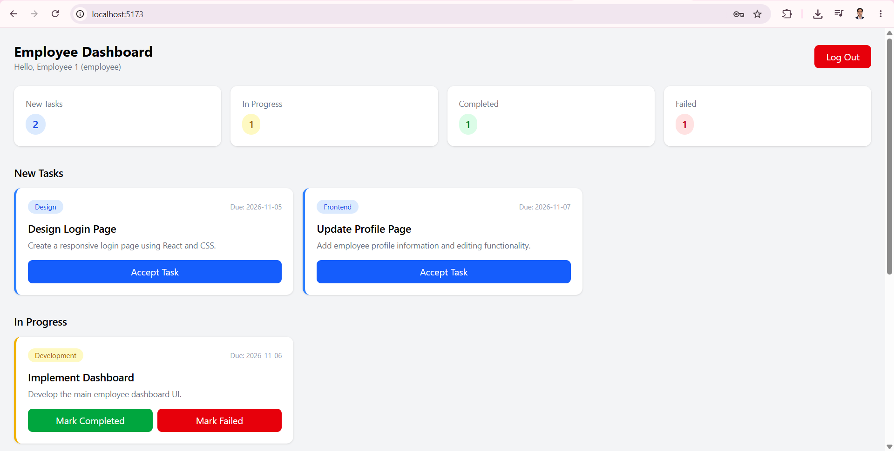
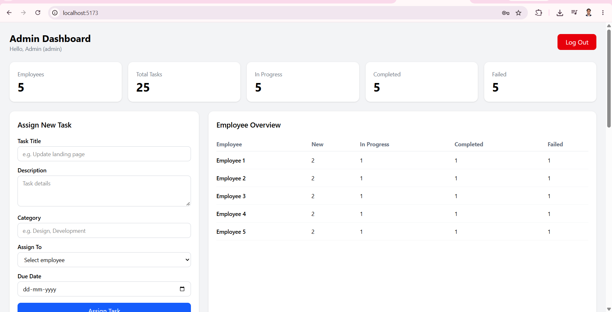

# Employee Management System

A frontend-only task management app where an admin assigns tasks and employees accept, complete or fail them. Built with React, Vite and Tailwind CSS.

**Live demo:** https://employee-management-system-three-jet.vercel.app/

## Features

- Login with separate admin and employee views
- Admin dashboard to create and assign tasks to employees
- Employee dashboard to view assigned tasks, accept them and mark them complete or failed
- Task status tracking (new, accepted, completed, failed)
- Data persisted in the browser using localStorage
- UI styled with Tailwind CSS

## Tech Stack

- React 19
- Vite
- Tailwind CSS v4
- Context API with custom hooks for auth and task state
- localStorage for data persistence

## Demo Credentials

| Role     | Email               | Password |
| -------- | ------------------- | -------- |
| Admin    | admin@gmail.com     | 123      |
| Employee | employee1@gmail.com | 123      |

## Screenshots





## Getting Started

```bash
git clone https://github.com/ritesh01-hub/employee-management-system.git
cd employee-management-system
npm install
npm run dev
```

Build for production:

```bash
npm run build
npm run preview
```

## Project Structure

```
src/
├── components/
│   ├── Auth/            # Login
│   ├── Dashboard/       # AdminDashboard, EmployeeDashboard
│   ├── TaskList/        # NewTask, AcceptTask, CompleteTask, FailedTask
│   └── common/          # Header
├── context/             # AuthContext, TaskContext
├── hooks/               # useAuth, useTasks
└── utils/               # localStorage helpers
```

## Notes

This project has no backend. All data lives in the browser's localStorage, so it is not shared across browsers or devices.

## Author

Ritesh Tiwari
[GitHub](https://github.com/ritesh01-hub) · [LinkedIn](https://www.linkedin.com/in/ritesh-tiwari-0a917737a/)
